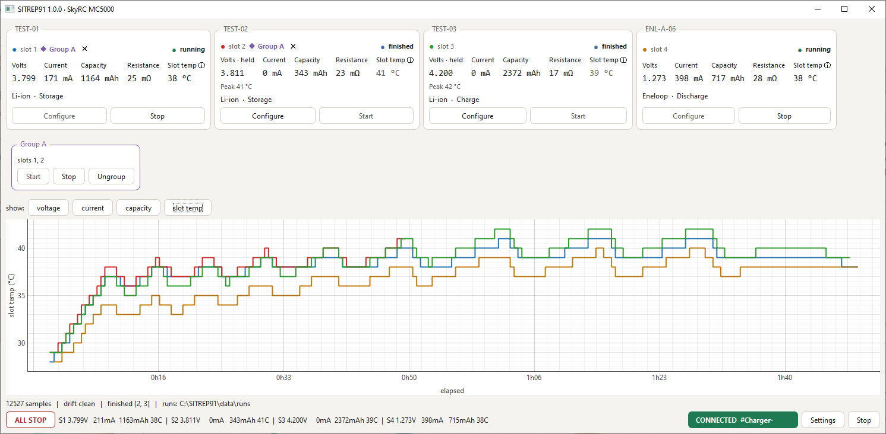

# SITREP91

A standalone telemetry and control app for the SkyRC MC5000.

SITREP91 talks to the MC5000 four-slot battery analyzer over Bluetooth. It
starts and stops each slot on its own, streams every reading to CSV files, one
per slot per run, and **reads the temperature of each slot**, which nothing
else I've found that talks to this charger can do.

<picture>
  <source media="(prefers-color-scheme: dark)" srcset="images/sitrep91-dark.png">
  
</picture>

*Four slots on one charger: two Li-ion cells in a group on storage, a Li-ion
charge, and an Eneloop discharging, with the slot temperature chart.*

It's an independent project, **not affiliated with or endorsed by SkyRC.**

SkyRC doesn't publish the Bluetooth protocol. Other projects have mapped parts
of it by watching the traffic between the charger and SkyRC's app, which only
shows the requests that app happens to make. I worked from the charger's
firmware, which shows every request the charger will answer, including a few
the app never sends, and then confirmed each one I use on the charger itself.

**Control is only enabled for the chemistries I've actually run on my own
charger: Li-ion (charge, discharge, storage) and NiMH, including Eneloop
(charge and discharge).** Anything else still shows up live and gets logged,
but the start button stays off until I've tested it. That's on purpose. The
charger can do more than SITREP91 lets it, and SkyRC's app will do all of it.
SITREP91 only sends the charger what I've tested on real hardware, because I'd
rather it do less than do something I can't account for.
[ROADMAP.md](ROADMAP.md), in the SITREP91 folder beside this README, shows
what's covered and what's next.

## Requirements

Windows 10 or 11, 64-bit, with Bluetooth LE (built in, or a USB adapter), and
a screen about 1600 pixels wide or more. The window opens compact and widens
as slots fill: about 1360 pixels with all four loaded, and up to about 1600
once a session has ended. On a narrower screen the right edge can run off, so move
the window left or use a wider display.

Mac and Linux aren't supported in v1. On Windows, if you'd rather run SITREP91
from the repo with your own Python than use the zip, I developed and tested it
on 3.13, and the tested package versions are in `requirements.txt` in the
repo. Other setups are on you.

```
python -m pip install -r requirements.txt
```

## Install (Windows)

1. Download `SITREP91-<version>-win64.zip`. Before extracting, right-click the
   zip, choose **Properties**, check **Unblock** at the bottom of the General
   tab, and click OK. Then **extract it** (right-click, Extract All). Don't run
   it from inside the zip. Windows only unpacks a double-clicked zip into a
   temporary folder, and the app will refuse to start there.
2. Put the extracted `SITREP91` folder wherever you like, such as Documents or
   a USB stick, but **not Program Files**. SITREP91 writes to its own folder.
   If you do unzip it somewhere it can't write, it shows a "Can't write here"
   dialog and offers to record to `Documents\SITREP91\runs` instead.
   Everything it needs is inside the folder, including its own Python, so
   nothing gets installed and nothing touches the rest of your system.
3. Double-click `SITREP91.bat`.

Only one copy of SITREP91 runs at a time. A second copy shows a message and
closes. The demo and Diagnose don't count, so you can run either alongside.

**If you skip Unblock,** Windows will ask before the first launch. Windows 10
shows "Open File - Security Warning" with a **Run** button. Windows 11 shows
"Windows protected your PC," with **Run anyway** hidden behind **More info**.
Either way, it's because SITREP91 isn't code-signed.

**Your data lives in `data\`**: runs, logs and `settings.ini` (if you took the
option above, your runs go to `Documents\SITREP91\runs` instead). To update,
extract the new version and copy your old `data\` folder into it, or replace
everything *except* `data\`. To remove SITREP91, delete the folder.

SITREP91 doesn't connect to the internet. It talks to the charger over
Bluetooth and writes everything it records to its own folder on your PC, or
the runs folder you choose in Settings.

**If you don't have a charger handy,** double-click `SITREP91_Demo.bat`. The
demo is fully interactive: Configure, Start, Stop and ALL STOP all work against
simulated readings, and it never looks for, connects to or sends anything to a
charger. The window title says "DEMO (no charger)," so you can't mistake it for
the real thing.

**Standard warning label:** don't leave charging cells unattended. You know
this, I know you know this, and it goes here anyway for the same reason it's
printed on every charger box. The charger's own safety timer is set on every
run SITREP91 starts, and it stays the backstop.

**And its companion label:** SITREP91 comes with no warranty. The MIT license
says so in capital letters, which is how lawyers tell you they really mean it.

**The charger doesn't detect chemistry.** It runs whatever the slot is set to,
including the setting left over from its last run. Check the chemistry and
values in Configure against the cell before every start.

## What SITREP91 does

- **Each slot runs on its own.** You can start a discharge on slot 1 while
  slot 3 is mid-charge, and stop either one without touching the other.
  SITREP91's automatic actions only ever touch slots it started, so a run you
  began at the front panel keeps going unless you stop it yourself.
- **Slots can be grouped.** In Configure, the "Also apply to" row copies one
  slot's settings to the others you check and makes them a group, and a Group
  card then starts or stops them together. The charger doesn't know about
  groups, so each slot still runs, stops and records on its own, with its own
  run folder. Cell names aren't copied, so name each slot before you group
  them, because configuring one slot on its own takes it out of the group.
  Discharging four at once runs into the charger's 20 W limit (see Known
  issues).
- **Everything goes to a CSV file, row by row, as it happens.** A crash or a
  lost connection costs you the readings while it's down, and everything
  before that is already in the file. If the run ends while the link is down, its
  capacity and time come up short, and the run is marked as such. Each row has
  voltage, current, capacity, elapsed time, internal resistance, slot
  temperature, and the charger's own account of what the slot is doing and why
  it stopped.
- **Every frame is checked.** Readings are validated structurally, against
  physically possible ranges, and against the integral of current over time.
  The failure to worry about here is a reading that parses cleanly and is
  simply wrong, since a crash at least announces itself. A frame that fails a
  check is still recorded and shown, but it's marked: in the CSV file (the
  `drift_severity` and `checksum_ok` columns), in the run's `meta.json`, in the
  session log for errors, and in the window, where the status bar reads
  "drift clean" or a count and a banner warns that the run is suspect.
- **Configure starts from the cell's capacity.** For a new setup, capacity
  starts blank, and Save stays off until you fill it in. A setup you reopen
  comes back with its capacity. The currents are worked out from it: 0.5C to
  charge and 0.2C to discharge, or 50 mA if that's higher (Storage uses both), capped at the charger's
  own panel defaults. The safety timer follows from the capacity and current.
  Values you type yourself, the timer included, are kept when the capacity or
  chemistry changes, except a cutoff that falls outside the new chemistry's
  range, which resets. Nothing below the panel's own minimums of 50 mA and
  100 mAh is sent. Configure warns you above 1C and asks you to check the
  cell's datasheet. An Advanced section has the panel's charge settings. Anything not
  in SITREP91 can still be set at the panel, and SITREP91 will watch and log
  that run.
- **Configure remembers your cell names.** It offers the names from your
  earlier runs, most recent first. Pick one, or type a new one. A new name
  shows up in the list after its first run. The field is barcode-scanner
  friendly: scan a cell label into it, and whatever your scanner sends at the
  end of a scan (CR, CR+LF, Tab, or nothing at all), the ID lands in the field
  and nothing starts. CR, CR+LF and Tab also move you on to the next field.
- **You confirm the settings before re-running a slot.** Once a run finishes,
  Start stays off until you go back through Configure and Save, even if
  nothing has changed. That's deliberate. The cell in the slot may not be the
  one that was there last time, so you check the settings against whatever's
  in there now.
- **Each slot's run gets its own folder**, holding the CSV file and a
  `meta.json` with the full configuration, the charger's alert, the final
  reading and why the run ended. `end_reason` says how the run ended from
  SITREP91's side, and `alert` says why the charger ended it (for example time
  limit, fully charged, or connection break if a cell was removed). A run that
  finished while the link was down is marked `ended_while_disconnected`. Its
  capacity, time and peak temperature are the last readings received, so treat
  them as floors, not the result. The charger's own reason is still in
  `alert`.

## Why SITREP91 instead of the vendor app

The MC5000 is already a capable machine on its own, with four slots
controlled independently from the front panel or from SkyRC's phone app. SITREP91 doesn't add
capability the charger lacks. It adds a computer.

- **SITREP91 stays with a run however long it takes.** A break-in cycle runs
  38 hours, a capacity test about six. SITREP91 watches the numbers for you,
  so you're not transcribing them off an LCD.
- **You get a file you can analyze.** Every reading is timestamped in a CSV
  file, where the panel gives you a summary figure that disappears when you
  clear the slot.
- **It stays out of the way.** A panel-started run and an app-started run can
  share the chassis. SITREP91 won't start, stop or change a slot unless you
  tell it to, and its automatic actions only touch the slots it started. Two
  controls reach further, both on your click. A slot card's Stop button will
  stop a panel-started run in that slot. **ALL STOP** halts every slot on the
  charger, panel runs included. It asks first, but don't press it while a
  panel run you care about is going.
- **Only one program can talk to the charger at a time.** Close SkyRC's app
  before opening SITREP91, and the other way round. If a run was started at
  the panel or in SkyRC's app, SITREP91 picks it up when you open it: it shows
  the slot running with live readings and records it, but not which action it
  is. Closing SITREP91 normally asks first and stops the runs it started,
  while a run started at the panel or in SkyRC's app is left alone. If
  SITREP91 crashes or is killed, the run carries on at the charger and
  finishes on its own safety timer.

## Why SITREP91 instead of other third-party tools

This is where the protocol work earns its keep. Several repeated
descriptions of the MC5000's protocol are wrong in ways that produce
plausible numbers instead of errors: a discharge that silently runs as a
break-in on a NiMH cell, an elapsed timer that restarts after 18 hours, a
capacity setting that quietly truncates a run so it reads as a bad cell. I
found each of those, measured it against hardware, checked it against the
charger's own firmware, and handled it.

Everything SITREP91 v1.0 uses to start or control a run was tested on this
charger, on firmware 2.02, during development that started in August 2026 and
ran to well over 200 recorded runs. On any other firmware it only watches.
Commands the charger accepts but I haven't tested, SITREP91 doesn't send.

There's also one measurement here that I haven't found in any other MC5000
tool, including SkyRC's own app.

## Slot temperature

Each of the MC5000's four bays has a temperature sensor, and SITREP91 reads
it. You'll see it on each slot's card, as the fourth chart, and as a column in
the CSV file.

This is the slot's temperature. I opened the charger and couldn't pinpoint
where each slot's sensor sits. I believe it's just under the surface, or
possibly at the battery contacts. If you need the cell's own temperature, that takes your own thermal probe on the cell.

What to expect:

- **Readings are in whole degrees Celsius.** The charger drops the tenths
  before sending.
- **The reading runs about 5 °C above the outside of the cell** once a run is
  warm, and about 2 °C above at the start (measured on one cell in one run).
  Absolute accuracy is uncalibrated, so treat it as diagnostic data, not a
  safety system. How it changes over a run is more trustworthy than the number
  itself.
- **The slots agree with each other.** With one cell running and the other
  bays empty, the same cell read 37 °C in all four slots once warm.
- **Middle bays read about 1 °C high** compared with the edges when all four
  slots are loaded. With all four running, the fan also cycles every six and a
  half minutes or so and moves every reading by 2 to 3 °C, so any single
  reading is a snapshot of that cycle.
- **It's polled about every 30 seconds, best effort.** Roughly 3 % of requests
  come back empty, so don't count on a reading at any particular minute.
- **It only reads while a slot is running.** An idle or finished slot reports
  nothing.
- **It needs firmware 2.02.** Temperature turns on once SITREP91 has read the
  charger's firmware version, and that read needs all four slots idle. The
  version is remembered for that charger afterward, so this only matters the
  first time. If you first connect while another slot is running, temperature
  stays off until there's a gap between runs. Beside a finished slot that's
  still showing its alert, give it about a minute.

**The "Stop at slot temp" setting in Configure ends a run when its slot *reaches*
the line you set.** It only works while SITREP91 is connected, and only on
slots SITREP91 started. On a slot started at the front panel it warns instead
of stopping.

The charger has no temperature setting on its panel. Its Bluetooth
configuration does carry a temperature-cutoff value, but in my testing,
setting one didn't make a run end. So SITREP91 doesn't rely on it. The
charger's safety timer and its own over-temperature trip, which the firmware
sets at 70 °C (read from the firmware, not tripped in my testing), stay in
charge either way. That trip reads the same in-bay sensor, which ran about
5 °C above the outside of the cell in my testing, so it should fire before the
cell itself reaches 70.

How it was found, and how I checked it's real:
[The epic tale of four slot temperatures](docs/slot-temperature.md).

## Stale resting voltage

When you leave a cell sitting in an idle bay, the voltage the MC5000 shows
you, on the panel and over Bluetooth, stops updating. It's held from the last
time the slot changed state: a cell going in, a run starting, a run stopping.
If you come back four hours after a discharge, you're looking at the voltage
from the last time the slot changed state, which after a long run is a couple
of minutes after it ended. To get a fresh reading, lift the cell and set it
back down. SITREP91 labels a resting slot's voltage "Volts · held".

The evidence, what this does to a run's recorded final voltage, and a
quick way to check it yourself with no software are in
[docs/resting-voltage.md](docs/resting-voltage.md).

## Troubleshooting

**To check the Bluetooth link without starting the app,** double-click
`SITREP91_Diagnose.bat`. It opens a console window and runs a ten-second
Bluetooth scan. It prints the SITREP91 and Python versions, whether the `data\` folder
can be written, whether a Bluetooth adapter is present, whether the charger is
advertising, and the firmware version remembered for it. It never connects to
the charger, so it's safe to run any time, even mid-run. The report is also
saved in `data\logs\`.

**If SITREP91 stops or won't start,** it shows a message naming a file in
`data\logs\` (`crash_<date>_<time>.log`). Attach that file when you
[report the problem](#reporting-problems). Every session also keeps its own log in `data\runs\logs\`.

**If SITREP91 says the charger can't be found but it's sitting right there,**
the charger may still be getting ready. After about two and a half minutes of
looking, SITREP91 says it can't find an MC5000 and offers a Retry button,
which looks again and keeps anything you've already configured. The marker
beside the Retry button shows CONNECTED or DISCONNECTED, so you can tell at a
glance whether SITREP91 has the charger. After SITREP91 closes cleanly, the
charger usually reappears within seconds (7 to 10 in my testing), but can take
up to about two minutes, and SITREP91 waits for it. If it never shows up, check that your phone's SkyRC app
isn't holding the connection, that the Bluetooth adapter is plugged in and on,
and that the Diagnose check can see it. Worst case, power-cycle the charger, which
ends any run on it.

## Command-line tool

The zip also includes `app\capture.py`, the core the app is built on, which
runs a capture without a window. There's no launcher for it: from the
`SITREP91` folder, run `python\python.exe app\capture.py --help` to see its
options. It's unsupported, and it follows the same whitelist: it won't start
anything the app won't. To start a run it needs `--capacity`, your cell's
rated capacity in mAh. It works out the current and the safety timer from that
the way the app does, unless you give them with `--current` and
`--safety-timer`. Storage uses the same current for charging and discharging;
the window app sets them separately.

## Reporting problems

Bug reports go to [GitHub issues](https://github.com/littlecitylabs/sitrep91/issues).
The most useful ones include:

- the crash log, if SITREP91 showed one (`data\logs\crash_<date>_<time>.log`)
- the Diagnose report, also in `data\logs\`
- your charger's firmware version, and whether you're on Windows 10 or 11
- what the charger's panel showed, especially for an "alert code N"
- the run's folder from `data\runs\`, if it's about a particular run

Reports from chargers on firmware other than 2.02 are welcome too, even if all
you can say is what happened when you connected. I'm one person, so replies
may take a while.

Logs, Diagnose reports and run folders can include your Windows user name (in
file paths) and your charger's Bluetooth address. GitHub issues are public, so
look them over first and trim anything you'd rather not post.

## Known issues

Which chemistries and modes SITREP91 can start is in
[ROADMAP.md](ROADMAP.md). This section is about behavior.

**Starting a run needs firmware 2.02, exactly.** That's the one version
SITREP91 was built and measured against. Its status frames are 24 bytes long,
where the earlier protocol write-ups describe 23, and I haven't tested
anything older. On any other version, or one that can't be read and isn't
remembered for that charger, starting is refused with a plain message saying
why, and slot temperature is off. SITREP91 remembers each charger's version
once it has read it, so if you update a charger's firmware, SITREP91 keeps
trusting the old version until the next time it can read it with all four
slots idle. On those versions SITREP91 is watch-only and
untested, and some status fields, such as the charger's own status, mode,
alert and chemistry, may be blank. **Don't update your
charger's firmware** if you want to keep using SITREP91. As far as I can
tell, SkyRC only offers the latest version, so an update can't be rolled
back. If yours is on another version, please
[report it](#reporting-problems).

**SITREP91 works with one charger at a time.** It connects to the first
Bluetooth device whose name contains "charger" or "MC5000", and it has no way
to choose between them. With two in range it could connect to either one, and
another maker's charger could match too, so keep a single MC5000 powered and
in range, with other Bluetooth chargers switched off. It doesn't support the MC3000.

**Discharge is limited to 20 W across the charger.** With four slots
discharging together, each gets about 5 W (around 1.35 A on Li-ion), and a
higher requested current is quietly reduced. Other combinations haven't been
measured. SITREP91 doesn't warn you about this.

**The charger silently replaces out-of-range settings with its defaults.**
SITREP91 checks the settings it sends against the ranges the charger honors
and refuses anything outside them, with a message naming the range. Several
of those ranges come from the firmware, and I haven't tested their edges on
the charger.

**A few things have happened exactly once.** I've seen the panel go blank and
unresponsive once, and couldn't make it happen again in three tries. I've seen
the charger stop advertising once after Windows' Bluetooth was switched off and
on, and haven't tried to repeat that. I'm putting them down to sunspots, or
possibly an ancient burial ground under the bench. If either happens,
power-cycle the charger before trusting it, because a run started in that
state can be acknowledged and never actually run. A power cycle ends any run on
the charger, so do it with nothing running if you can.

**Nickel keep voltage can only be set at the charger's panel.** The charger
accepts it over Bluetooth and then ignores it, so SITREP91 doesn't offer it
for NiMH or Eneloop. Li-ion keep voltage works.

**A panel-started break-in looks like it's still running after it
finishes.** Break-in is monitor only in SITREP91 for now (see
[ROADMAP.md](ROADMAP.md)), so this only happens with one started at the panel
and watched. The charger keeps reporting the last current, so SITREP91 can't
tell the run has ended. The card goes on showing it, the CSV file keeps adding
identical rows, and the slot can't be started from SITREP91 until you clear
the Done message at the panel.

**A charge started on a cell that's already full ends at once.** If the cell
is above the charge target, the charger shows "Fully Charged!" and SITREP91
records the run as done, with nothing sent twice.

**The charger reports why it stopped a run.** SITREP91 names the four reasons
I've seen on real hardware: capacity limit, time limit, connection break and
fully charged. Any other reason shows as "alert code N." That includes the
charger's own over-temperature trip, which I haven't triggered and am in no
hurry to. The charger's panel shows its own message either way. If you see
one, please report the number and what the panel said. Those reports are how
codes get named (see [ROADMAP.md](ROADMAP.md)).

**A resting cell's voltage doesn't update on its own**, on the charger's panel
as well as in SITREP91. See [docs/resting-voltage.md](docs/resting-voltage.md).
It's the charger doing this.

**A run's recorded final voltage isn't quite final.** After a run ends, the
cell's voltage keeps relaxing. It rebounds upward after a discharge, and
settles downward after a charge. The charger re-measures it a couple of times
over the next few minutes, after the capture has stopped listening. After one
short discharge the shift was about 30 mV. Details in
[docs/resting-voltage.md](docs/resting-voltage.md).

**A CSV file shows 0 bytes in Explorer while SITREP91 has it open.** The data
is there. Every row is handed to Windows as it arrives, and Windows only
updates the size it shows once the file is closed.

**Before a long panel-started run, check the charger's own time limit.** Runs
started from the front panel follow the time limit in the charger's own menu,
and its default is shorter than a full low-rate capacity test. A
panel-started run that dies at exactly four hours with a "Time Limit" banner
has hit it. (Runs SITREP91 starts carry their own timer, which Configure sets from the
cell's capacity and current.)

**The charger's Bluetooth PIN popup is harmless.** Connecting often makes the
charger flash a PIN on its screen. It's an invitation to pair. Nothing here
needs pairing, and it doesn't stop, pause or disturb a run. Ignore it, or
clear it with the Slot button. It doesn't get in the way of anything SITREP91
does.

**While a slot is busy, SITREP91 asks Windows not to sleep.** Busy means a run
is open, a start is pending, or current is flowing. Once nothing is running,
it lets go after three minutes, so an idle window doesn't keep the PC awake.
That doesn't
stop you closing the lid or choosing Sleep yourself, and some laptops with
Modern Standby may still drop into low power with the screen off. To see
whether SITREP91 is holding its request, run `powercfg /requests` from an
administrator command prompt during a run. If the PC does sleep, the charger
carries on by itself and its safety timer still governs, but SITREP91 loses
the readings for that time. After the PC wakes, SITREP91 reconnects on its
own (seen on the bench).

**Closing SITREP91 stops the runs it started.** It asks first, and it only
ever stops slots it started, never one you started at the panel. If the link
is down when you close, it says so, because it can't stop anything then.

## What state this is in

Version 1.0.0. It works, and I use it on my own bench.

That bench is the entire test program: one charger, one firmware version
(2.02), one person. Nothing here has been confirmed on a second unit. Where a
finding rests on inference rather than measurement, I've said so. Several
measurements overturned things I'd concluded earlier, and I corrected them.

Well over 200 recorded runs sit behind the protocol claims. The
charger's own safety timer is measured to fire, including after the
controlling software is hard-killed, so a laptop going to sleep can't leave a
run driving a cell indefinitely.

If you have an MC5000 and a tolerance for filing bug reports, I'd like to hear
how it goes on yours.

What I plan to work on next, and the rough order, is in
[ROADMAP.md](ROADMAP.md). There are no dates on it, because this happens in my
spare time.

## Why it isn't called SuperBatteryAnalyzer 5000 or BatteryChargenatorDeluxe

Names are hard. For me, anyway. I spent two days on this one, looking for
something that didn't borrow from SkyRC's trademarks and didn't land on top of
another product or project, and that turned out to be a lot harder than it
sounds. Most of the good names were taken. A surprising number of the rest
were taken by someone with a trademark filing.

SITREP stuck because a sitrep is a situation report: where things stand right
now, in plain numbers. That's the job here. It also sounded serious, maybe too
serious for a hobby tool attached to a battery charger, and that tickled my
irony bone enough to keep it.

The 91 is `0x91`, the MC5000's status frame. It carries the voltage, current,
capacity, elapsed time and resistance for every reading. Slot temperature
comes from a separate request, `0x55`, covered in
[the epic tale](docs/slot-temperature.md).

## Credits

SITREP91 started from rssdev10's
[skyrc-mc-rs](https://github.com/rssdev10/skyrc-mc-rs) (MIT, Copyright 2026
Roman Samarev), whose protocol notes and command-line tool were the map for
the first packets this app sent. The full notice is in
`THIRD_PARTY_NOTICES.md`. Thanks also to kolinger's
[skyrc-mc3000](https://github.com/kolinger/skyrc-mc3000) for the prior work on
the MC3000 side of the family.

Claude (Anthropic) wrote a lot of the code, working from my direction and more
than a few of my hunches (the slot temperature started as one). Nothing that
controls the charger was switched on until it had been tested on the bench,
and v1.0 went through blind reviews before it shipped.

SITREP91 is a Little City Labs project by minimumflair.

## License

MIT. See `LICENSE` and `THIRD_PARTY_NOTICES.md`.
